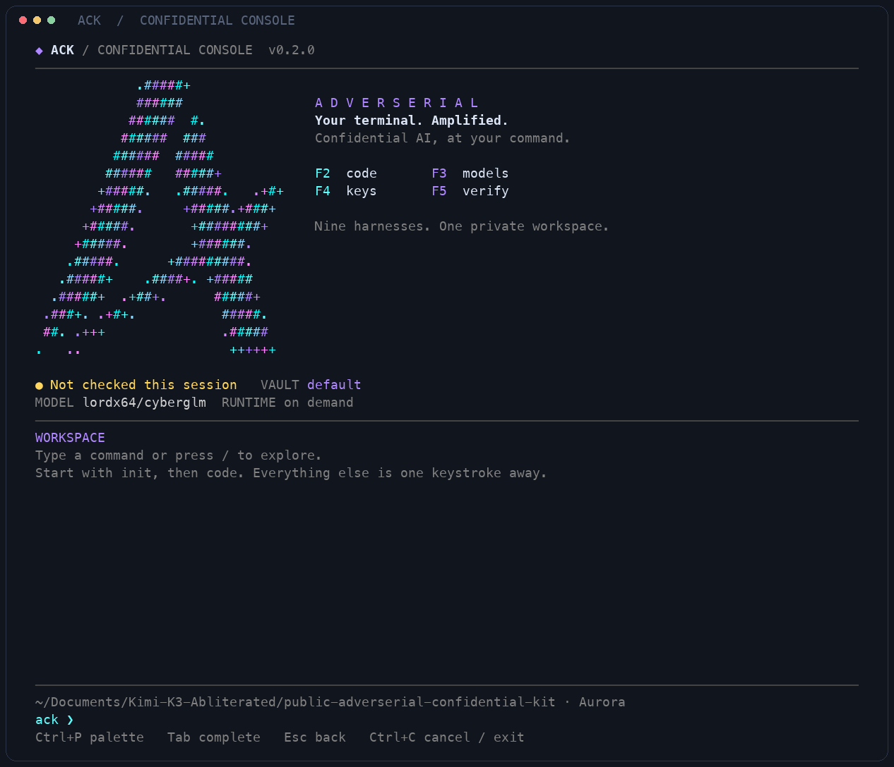

# Adverserial Confidential Kit

`adverserial-confidential-kit` turns the existing confidential SDK, gateway,
and harness integrations into one local command-line workflow.

```sh
# After the first npm release
npm install -g adverserial-confidential-kit

# Or install the current public GitHub source now
npm install -g github:AdverserialAI/adverserial-confidential-kit

ack
```



Running `ack` opens the **Confidential Console**: a full-screen workspace with
an original Adverserial ASCII mark in color, searchable pickers, encrypted key
profiles, a session verification badge and a live activity area. Existing
single-command workflows still work from a normal shell.

## The console

- **Command palette:** press `/` or `Ctrl+P`, type to filter, then Enter.
- **Coding harnesses:** `code` or F2. Arrow keys, a number, or a search choose
  among Claude Code, Codex, OpenCode, Pi, Oh My Pi, ZCode, DeepSeek Harness,
  Hermes and Kimi Code. The picker detects which CLIs are actually installed.
- **Models:** `models` or F3 fetches the published registry. Select a model to
  activate it and its matching receipt-key policy. The model must have an
  active policy; a model name alone cannot bypass verification.
- **Encrypted key vault:** `keys` or F4. Add, replace, activate and delete
  profiles. Key entry is masked and excluded from command history.
- **Attestation:** `attestation` or F5 runs a fresh independent check and shows
  the complete evidence report. The badge starts unverified, expires with the
  evidence, and rejects unpinned or synthetic evidence as a verified state.
- **Swarms:** `swarm` opens a task/room menu. Select two or more installed
  harnesses with Space, press Enter and write a shared task brief. Only the
  harnesses you explicitly select are launched.
- **Diagnostics:** `doctor` checks installed harnesses, runtime files, local
  configuration and receipt-key pins. `status` reads local metadata.
- **Colors:** `theme` or F6 selects Aurora, Ultraviolet, Ember or Glacier.
  `motion off` freezes the activity indicator. Preferences persist locally.

`Tab` completes commands. Up/Down browse in-memory command history. Escape goes
back or cancels input; Page Up/Down scroll the activity area. `Ctrl+L` redraws;
`exit` returns to the normal terminal. The console handles terminal resizing
and hands exclusive terminal control to each child harness, then restores
itself when the harness exits.

The shell adds **no UI dependencies**, performs no network or Keychain calls
on startup, and repaints only rows that changed. Model discovery and
verification happen when requested. Console history and verification state
stay in memory; API-key values never enter the activity log or preferences.
`NO_COLOR` disables colors, and noninteractive/dumb terminals receive ordinary
command help instead of a full-screen UI.

```sh
ack                     # Open the console
ack code                # Open the console directly at the harness picker
ack code oh-my-pi        # Launch a specific harness directly
ack harnesses           # See which harnesses are installed
ack models              # Print published models
ack model lordx64/cyberglm
ack status              # Local metadata; no vault unlock
ack doctor              # Workstation checks
ack theme ultraviolet   # Persist the console palette
```

`ack init` asks for an Adverserial API key once, downloads the active public
policy, pins its receipt keys in `~/.config/adverserial/receipt-keys.json`,
and prepares a private local confidential runtime in `~/.config/adverserial/venv`.
Both local config files use mode `0600`; the directory uses mode `0700`.

## API-key profiles

Keep separate personal, team, or client API keys and switch the active key
without reconfiguring a harness:

```sh
ack keys list
ack keys add personal
ack keys add acme-security
ack keys modify acme-security
ack keys use acme-security
ack keys delete personal
```

Inside the console, `keys` opens a searchable vault with activation, replacement
and deletion actions. Destructive deletion asks for the profile name; the
active key cannot be deleted.
Key input is shown as bullets and profile lists show only a short masked
fingerprint. On macOS, ACK generates an AES-256-GCM storage key in the macOS
Keychain and writes only ciphertext, nonce, authentication tag, and a masked
fingerprint to `~/.config/adverserial/ack.json`. The ACK vault stores no plaintext API-key
material. Existing ACK state is migrated on its next command.

`ack code` handles the confidential runtime end to end: it starts it only for
the selected harness session, waits for it to become healthy, and stops it when
the harness exits. It refreshes the private runtime automatically after an
installed kit update. The runtime verifies fresh attestation and hardware
evidence, exchanges the API key with billing for a one-use entitlement,
encrypts requests to the runtime, and requires a signed inference receipt
before accepting a completed stream. The model endpoint never receives the
saved API key.

```sh
ack code claude
ack code codex
ack code opencode
ack code pi
ack code hermes
ack code kimi
ack models
ack attestation
ack upgrade
```

## Confidential swarms

Use `ack swarm` when a task benefits from independent coding-agent views. It starts one verified gateway for the whole job, limits workers to two by default, gives each worker a shared local brief, and asks a lead harness to reconcile their reports. Prompts and reports remain in the local swarm directory under `~/.config/adverserial/swarms/`.

```sh
ack swarm --agents claude,codex --workers 2 --lead claude \
  "audit this repository and propose a minimal fix"
```

The default selects every supported harness. Use `--agents` to choose a smaller group when you want to control usage or focus the review.

### Connecting already-open sessions

Harnesses do not expose a safe API for another process to inject text into an existing private conversation. Instead, `ack` provides a local file-backed room that active agents can explicitly join on their next turn:

```sh
ack swarm create incident-review
ack swarm invite --to pi "Review the streaming adapter and post the failure mode."
ack swarm inbox --agent pi
ack swarm post --from pi --to claude "Found the issue and saved a patch at …"
```

This lets a Claude session delegate work to an already-open Pi session, and lets Pi report back, without copying either session’s hidden conversation, credentials, or prompt history. The Claude integration recognizes explicit swarm requests, and the Pi integration exposes `adverserial_swarm_inbox` and `adverserial_swarm_post` tools when launched through `ack code pi`. An already-open Pi session receives the task on its next turn when it reads its inbox; the kit never injects text into a terminal in the background. All room artifacts are private local files under `~/.config/adverserial/swarm-rooms/`.

The target harness must already be installed. The kit creates an isolated
Codex profile and ephemeral OpenCode/Hermes config snippets; it does not
overwrite the user’s normal provider configuration. This repository is the source of the public `adverserial-confidential-kit` package. Before the first npm release, configure npm trusted publishing for this GitHub repository; the included release workflow then publishes the tagged package with provenance.

### Harness selection

Run `ack`, then `code`, to choose a searchable keyboard-driven launcher menu. ACK configures the
local receipt-verifying gateway and starts the selected installed harness.

Supported launchers are Claude Code, Codex, OpenCode, Pi, Oh My Pi (`omp`),
ZCode, DeepSeek Harness (`dsh`), Hermes, and Kimi Code. `ack code codex`
also installs the published `adverserial-verify` Codex plugin; invoke it in
Codex as `$adverserial-verify` or choose it from `/skills`. It also adds
the slash-prompt fallback `/prompts:adverserial-attestation` for Codex builds
that show custom prompts in their slash menu. Start a new Codex session after
installation so it loads either entry. Pi and Oh My Pi expose
`/adverserial-verify` and show the current attestation verdict in their footer.

## Development

```sh
npm ci
npm test
npm run test:terminal  # macOS/Linux PTY integration checks
npm run smoke
node bin/ack.mjs
```

The terminal renderer lives in `lib/console.mjs`, logo artwork in `lib/art.mjs`,
and confidential runtime/key/harness operations in `lib/ack.mjs`. Tests cover
terminal handoff and restoration, encrypted-profile operations, secret masking,
policy references, evidence expiry and existing harness configuration.
Encrypted key storage currently requires the macOS Keychain; other operating
systems need a credential-store implementation before `init` can save keys.
