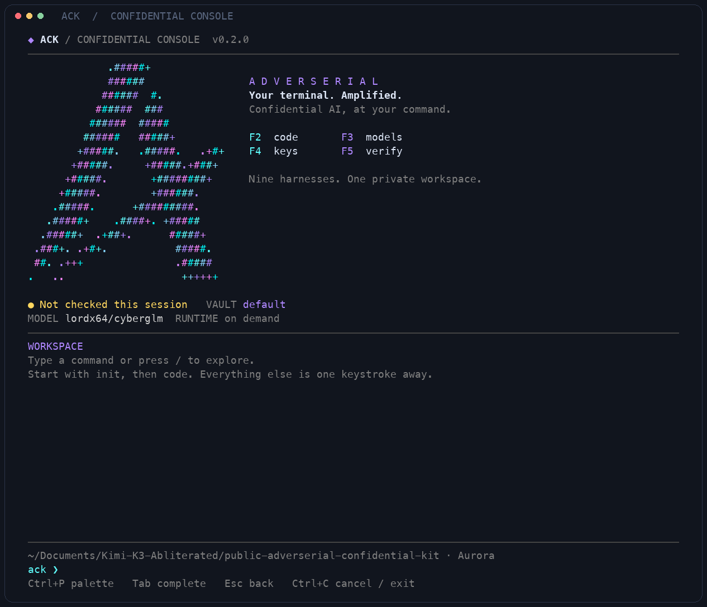
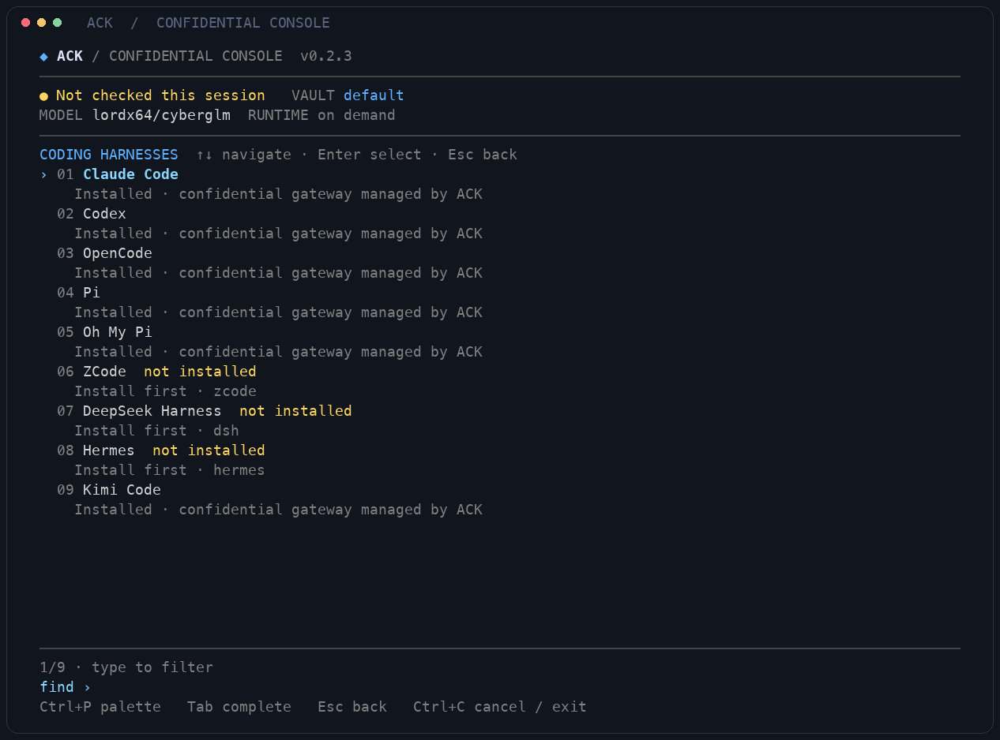

<div align="center">

# ACK · Adverserial Confidential Kit

### Your coding agents. One confidential console.

[](package.json)
[](package.json)
[](#requirements)
[](LICENSE)

[Website](https://adverserial.ai) · [How confidentiality works](https://adverserial.ai/confidential/) · [Verify a runtime](https://verify.adverserial.ai) · [SDK](https://github.com/AdverserialAI/confidential-sdk) · [Server source](https://github.com/AdverserialAI/attest-proxy) · [Transparency log](https://github.com/AdverserialAI/cyberseek-transparency) · [Security](mailto:security@adverserial.ai)

</div>

ACK prepares and manages the local confidential gateway, stores named API keys
in an encrypted vault, and connects your preferred coding harness to verified
Adverserial inference. Run it as a colorful interactive console or use ordinary
shell commands.



**New in 0.2.5:** checks the hardware-verifier dependencies before launching a
coding session. Pi and Oh My Pi footers expire with the proof and clear their
verified state after a gateway verification failure. Linked source installations
must run `npm ci` in the checkout; `ack doctor` checks that the verifier can load.

**New in 0.2.4:** Hermes launches with its current supported CLI options; the
local URL comes from its isolated provider configuration. Failed native launches
keep their diagnostic output visible until you press Enter or Escape.

**New in 0.2.3:** run coding sessions in multiple terminal windows. Each session
gets its own local gateway and connection settings; closing one leaves the others
running. Runtime installation is coordinated across simultaneous launches.

[Get started on the website](https://adverserial.ai/documentation) ·
[Release validation](docs/TESTING.md)

## Install → initialize → code

Install the current public GitHub source:

```sh
npm install -g github:AdverserialAI/adverserial-confidential-kit
ack init
ack code
```

Enter your Adverserial API key when prompted. Input is masked. ACK fetches the
active verification policy over HTTPS, pins its receipt keys locally and installs
an isolated Python gateway runtime. Choose an installed harness and start working.
The policy document itself is not signed; see
[what ACK verifies and what it does not](#what-ack-verifies-and-what-it-does-not).

Run `ack` to open the full-screen console. Inside it, use `init`, `code`,
`models`, `keys`, `attestation` or the searchable command palette.

Once an npm registry release is published, the equivalent install command is
`npm install -g adverserial-confidential-kit`. The GitHub command above works
without waiting for that release.

### Requirements

- **macOS or Windows** for encrypted key storage through Keychain or Windows
  DPAPI (bound to your Windows account). Linux credential storage is not yet implemented.
- **Node.js 18+**, npm and **Python 3.10+** on PATH. Checking the policy's
  transparency signature needs **Node.js 22.22.2+, 24.15+ or 26+**; on older
  Node the check is skipped with a warning in this release, and a later
  release that enforces signatures will require one of those versions.
- An Adverserial API key with access to a currently published confidential model.
- The official CLI for each harness you want to use. ACK detects installed
  binaries and reports missing ones; it does not install every agent for you.
- Network access for installation, published policy, independent hardware
  verification, billing entitlements and confidential inference.

ACK keeps its own runtime under `~/.config/adverserial/venv`; it does not replace
your normal Python environment. Existing harness executables are reused. An upstream harness may show its own
first-run theme or workspace-trust dialog; ACK does not bypass those choices.

On Windows, run the same `ack init` and `ack code claude` / `ack code codex`
commands from PowerShell or Windows Terminal. ACK recognizes native `.exe`
launchers and npm `.cmd` shims, including per-user npm and `.local/bin` installs.
It also finds the CLI bundled under `%LOCALAPPDATA%/OpenAI/Codex/bin` when no
standalone Codex CLI is on PATH. `ack code codex` opens a CLI session; it does
not change the provider of an already-open desktop chat. Use `ack harnesses`
to see the selected executable, or `ACK_CODEX_BIN` / `ACK_CLAUDE_BIN` (and the
corresponding override for other harnesses) to choose a specific installation.

Windows settings default to `%USERPROFILE%/.config/adverserial` when `HOME`
is unset; `ACK_HOME` still overrides this location. The `storage-key.dpapi`
file contains only the Windows-protected storage key. Keep it with `ack.json`
when backing up the vault; it is not portable to a different Windows account.
Older Codex versions without `plugin add` use the bundled local attestation
skill. Other harnesses still require an upstream CLI that supports your OS.

## The Confidential Console

| Control | What it does |
| --- | --- |
| `/` or Ctrl+P | Search the command palette. |
| `code` or F2 | Search, number-select or arrow-select an installed coding harness. |
| `models` or F3 | Browse the public registry and activate a model with its matching active policy. |
| `keys` or F4 | Add, replace, activate and delete encrypted named API-key profiles. |
| `attestation` or F5 | Run a fresh independent hardware and pinned-receipt check. |
| `theme` or F6 | Choose Aurora, Ultraviolet, Ember or Glacier. |
| `swarm` | Select harness workers or manage a local collaboration room. |
| `doctor` / `status` | Inspect installed tools, runtime files, key pins and local configuration. |
| `motion off` / `motion on` | Disable or enable the activity animation. |

A compact five-line A appears beside the wordmark in a single accent color.
Narrow terminals use a three-line version.
Preferences persist locally. Tab completes commands, Up/Down browse in-memory
history, Escape returns or cancels, Page Up/Down scroll, and Ctrl+L redraws.
The console handles terminal resizing and restores itself after a harness exits.

Startup is local: no Keychain unlock or network fetch is required to draw the
first frame. The renderer has no additional UI dependencies and updates changed
rows. `NO_COLOR` disables colors; noninteractive terminals receive command help.

## Coding harnesses

Choose from nine integrations in the searchable picker. Missing executables are
clearly marked; install the official harness CLI before selecting it.



```sh
ack code claude
ack code codex
ack code opencode
ack code pi
ack code oh-my-pi
ack code zcode
ack code deepseek-harness
ack code hermes
ack code kimi
ack harnesses
```

| Harness | Binary | ACK integration |
| --- | --- | --- |
| Claude Code | `claude` | Bundled verification plugin, native attestation command and attestation status line. |
| Codex | `codex` | Confidential provider profile, published verification plugin, local skill and custom-prompt fallback. |
| OpenCode | `opencode` | Isolated provider configuration, local verifier plugin and attestation slash command. |
| Pi | `pi` | Verified provider extension, verification tool/command, footer and collaboration tools. |
| Oh My Pi | `omp` | Verified provider extension, verification tool/command, footer and collaboration tools. |
| ZCode | `zcode` | Versioned provider configuration and process-scoped gateway credential; billing key stays out of the provider file. |
| DeepSeek Harness | `dsh` | Confidential provider and default model; interactive Web profile and headless worker profile. |
| Hermes | `hermes` | ACK-owned provider configuration, environment credential reference and verification skill. |
| Kimi Code | `kimi` | Managed model alias, environment credential reference and verification skill. |

ACK configures each selected harness rather than changing the executable itself.
OpenCode and Hermes use ACK-owned configuration directories. Codex receives a
separate confidential profile and verification integrations in its selected
`CODEX_HOME`. Kimi's managed block preserves unrelated existing TOML settings.

For binaries outside PATH, set an absolute executable override, for example:

```sh
export ACK_CODEX_BIN=/absolute/path/to/codex
export ACK_OMP_BIN=/absolute/path/to/omp
export ACK_DSH_BIN=/absolute/path/to/dsh
ack code codex
```

Other overrides are `ACK_CLAUDE_BIN`, `ACK_OPENCODE_BIN`, `ACK_PI_BIN`,
`ACK_ZCODE_BIN`, `ACK_HERMES_BIN` and `ACK_KIMI_BIN`. Oh My Pi uses its own
agent state directory; `OMP_CODING_AGENT_DIR` can override it without reusing a
Pi-specific `PI_CODING_AGENT_DIR` setting.

## Attestation and verification

```sh
ack attestation
ack attestation --json
```

The verifier checks pinned receipt keys, fresh endpoint evidence, the expected
model and policy, independent hardware evidence, and the quote-bound transport
identity. The gateway verifies the confidential request path and signed final
inference receipt separately. Failed, stale, unpinned or synthetic evidence is
not a verified confidential runtime.

### Policy transparency

The verification policy tells ACK which deployment to accept, so whoever can
change the policy can change what "verified" means. Until now ACK took the
policy from `https://verify.adverserial.ai/policies/production.json` on HTTPS
trust alone. From 0.2.15 ACK also checks that the exact bytes it received were

1. **signed by the publishing workflow**: a Sigstore certificate issued to
   `https://github.com/AdverserialAI/confidential-policy/.github/workflows/sign-policy.yml@refs/heads/main`
   by `https://token.actions.githubusercontent.com`, for a `push` to `main` of
   that repository (the repository and organization are also matched by their
   numeric GitHub ids);
2. **recorded in the public Rekor transparency log**, with an inclusion proof
   in the signature bundle served next to the policy
   (`production.json.sigstore.json`); and
3. **not older than a policy this installation already accepted**, ordered by
   the log's own time, which the signer cannot choose. Each release also
   carries a floor, so a fresh installation cannot be handed an old policy.

The check is offline, against the Sigstore trusted root shipped in
`resources/sigstore/trusted_root.json`. There is no signing key: nobody,
including Adverserial, can publish a policy that ACK accepts as signed without
leaving a permanent public log entry under that one identity.

```sh
ack policy            # status: signed / unsigned / unverifiable, signer, log index, integrated time
ack doctor            # includes a "Policy transparency" line
ack attestation       # prints the same line before evaluating hardware evidence
ack policy enforce    # refuse a policy that is not signed and logged (opt in now)
ack policy warn       # back to the default of this release
```

| Status | Meaning |
|---|---|
| `signed` | Signature, log inclusion, signer identity and rollback check all passed |
| `unsigned` | No signature bundle is published next to the policy |
| `unverifiable` | A bundle exists but was not accepted (wrong signer, bad signature, older than the accepted policy), or this Node.js is too old to run the verifier |

**This release only warns.** In the default `warn` mode ACK verifies whenever
a bundle is published and tells you the result, but an unsigned or
unverifiable policy is still used, exactly as before 0.2.15. Set
`ACK_POLICY_TRANSPARENCY=enforce`, or run `ack policy enforce`, to refuse it
today. A later release will enforce by default and will then require Node.js
22.22.2+, 24.15+ or 26+.

What it does not prove: that a policy is *right*. Whoever can merge to `main`
of the policy repository and approve its signing environment can sign a policy
for a different deployment. Signing makes that public and attributable, not
impossible, so it only helps if the log is watched; the
[transparency repository](https://github.com/AdverserialAI/cyberseek-transparency)
runs a monitor and anyone can run their own. Verify a policy by hand:

```sh
curl -sSO https://verify.adverserial.ai/policies/production.json
curl -sSO https://verify.adverserial.ai/policies/production.json.sigstore.json
cosign verify-blob --bundle production.json.sigstore.json \
  --certificate-identity https://github.com/AdverserialAI/confidential-policy/.github/workflows/sign-policy.yml@refs/heads/main \
  --certificate-oidc-issuer https://token.actions.githubusercontent.com \
  --certificate-github-workflow-trigger push production.json
```

Decisions in this release that can still be revisited before enforcement: the
signing identity above (it becomes permanent once clients enforce), rollback
order by log time plus a per-release floor, and the Node verifier as the single
enforcement point. `ack`, the hardware verifier that the gateway runs for
every verification, and the bundled TypeScript SDK under Node all use
`lib/policy-transparency.mjs`. The Python SDK has the same check as an optional
extra (`pip install 'adverserial[transparency]'`, Python 3.11+) for standalone
use. The verifier copies bundled inside the harness plugins do not check the
signature yet; in an `ack` session the policy they compare against has
already been checked by `ack` and the hardware verifier.

### What ACK verifies and what it does not

The service is [attest-proxy](https://github.com/AdverserialAI/attest-proxy)
(v0.1.0-rc.33 at the time of writing) running in an Intel TDX confidential VM in
front of an SGLang model server that is reachable only on the VM-internal
network. Since rc.31 every server private key is generated inside the enclave:
the receipt key (P-256) and the meter key (Ed25519) on first boot, the
encrypted-body (EHBP, X25519) key afresh at every boot and held in memory only,
and the TLS key by in-enclave ACME. The operator does not provision or hold any
of them. Releases up to rc.30 used operator-generated seeds and a fixed EHBP
identity.

**Checked on every `ack attestation`, and by the gateway before any prompt is sent:**

- **Attestation receipt.** ES256 signature against a receipt key pinned on this
  machine (`receipt-keys.json`), plus the fresh nonce, issuer, audience, model,
  endpoint, expiry and the digest of the returned evidence.
- **Intel TDX quote.** Verified locally with `@phala/dcap-qvl` against Intel
  collateral fetched through Phala's PCCS. The TCB status must be `UpToDate`;
  any other status, and any debug-enabled TD, is rejected.
- **Quote binding.** The quote's `report_data` must equal
  `SHA-256("adverserial-attestation-v2\0" || nonce || TLS SPKI || receipt-key SPKI || EHBP public key)`
  followed by 32 zero bytes. This ties the fresh nonce and the three public keys
  to the quote.
- **Event-log replay.** RTMR3 is recomputed from the dstack event log and must
  equal the quoted value. MRTD, RTMR0–2, the application id, the compose hash
  and the OS image hash are then compared with the published policy.
- **Workload policy.** Model digest, runtime image digest, deployment
  configuration digest, proxy release, TLS key and receipt key are compared with
  the published policy. No measurement, OS image or key value is compiled into ACK.
- **NVIDIA evidence.** Every NRAS token is verified against NVIDIA's published
  signing keys, the overall result must be true, each per-GPU token must match
  its digest, the bundle must be fresh, and the GPU count must meet the policy
  minimum.
- **TLS key pinning.** The gateway accepts exactly the quote-bound TLS public key
  on every connection and checks it after the handshake, before any request
  bytes or credentials are written.
- **Encrypted bodies (EHBP).** Requests are HPKE-encrypted to the quote-bound
  X25519 key and responses are decrypted locally; a plaintext fallback is refused.
- **Per-inference receipt.** Each completed response must carry a receipt signed
  by the attested receipt key and bound to the request nonce, the exact request
  and response bytes, the model, the TLS key and the attestation state.

**Not checked by ACK:**

- **The published policy is not signed.** It is fetched live over HTTPS from
  `https://verify.adverserial.ai/policies/production.json`; its integrity rests
  on that host and its TLS certificate. Only the receipt keys are pinned locally.
  A changed policy cannot make a different enclave pass between upgrades, because
  that enclave cannot sign with the pinned receipt key. `ack init` and
  `ack upgrade` pin whatever policy is published at that moment, so compare it
  with the [transparency log](https://github.com/AdverserialAI/cyberseek-transparency)
  before re-pinning if you want an independent check.
- **The key-attestation statement.** The server publishes
  `GET /.well-known/adverserial-key-attestation` (all public keys with
  `keys_origin: enclave-generated`, in a quote whose `report_data` is
  `SHA-512("adverserial-key-attestation-v1\n" || statement)`). ACK does not fetch
  or verify it yet. ACK proves that the keys are bound to the attested enclave,
  not where they were generated; that follows from the measured server source.
- **GPU-to-quote binding.** ACK verifies that the NVIDIA tokens are genuine,
  fresh and consistent with each other. It does not check that their nonce is
  tied to the TDX quote or to the client nonce. The link between the GPUs and
  this VM is the evidence digest signed by the quote-bound receipt key.
- **The GPUs' protected mode.** Since 2026-11-24 the service runs on OS image
  `dstack-0.6.5`, and its measured configuration tells the OS not to attest
  the GPUs at boot (`"attest_gpu": false`). The hosting provider set this
  because the OS's check does not recognise the multi-GPU Protected PCIe mode
  that the eight H200 GPUs run in. Nothing in the measured boot chain
  currently verifies that mode, and ACK does not either: the NVIDIA tokens it
  checks show genuine GPUs, accepted firmware, secure boot and debug off, not
  the mode. The setting is part of the measured configuration, so it is
  covered by the compose hash ACK compares with the policy; ACK does not
  report it separately. The independent verifier in
  [AdverserialAI/cyberseek-transparency](https://github.com/AdverserialAI/cyberseek-transparency)
  prints it as a warning on every run.
- **Source-to-measurement mapping.** ACK compares measurements with the policy.
  It does not rebuild the OS image (`dstack-0.6.5`), the proxy or the
  compose file to show that the policy values correspond to public source.
- **The model server.** ACK does not attest SGLang separately; it is covered only
  through the measured deployment configuration.
- **The meter key and billing.** Usage metering signatures are verified by
  billing, not by ACK.
- **TLS pinning in the Node verifier.** `ack attestation` and the harness badges
  check that the TLS key in the evidence is quote-bound and matches the policy,
  but Node's `fetch` cannot pin the connection it uses. Channel pinning is
  enforced by the gateway, which is the only component that sends prompts.
- **Your own machine.** Harness CLIs, their tools and other local processes run
  with your account's access. Status badges and cached verdicts are local
  information, not a security boundary.

For a check that does not depend on ACK, use the independent verifier and the
attestation history in
[AdverserialAI/cyberseek-transparency](https://github.com/AdverserialAI/cyberseek-transparency).

The console badge starts unchecked and expires with the evidence. Supported
harness interfaces expose verification as follows:

- **Claude:** `/adverserial-verify-claude:attestation`; the bottom status line
  displays the cached verdict and refuses expired or unpinned evidence.
- **Codex:** select the installed `adverserial-verify` plugin skill with
  `$adverserial-verify` or `/skills`. ACK also installs `$adverserial-attestation`
  and `/prompts:adverserial-attestation` for CLI versions supporting custom
  prompts. Restart Codex after installation. A Claude-style custom attestation
  status line is not provided by this integration. If marketplace plugin setup
  fails, ACK reports it and continues with the bundled local attestation skill
  and verifier; confidential inference verification remains enforced.
- **OpenCode:** `/adverserial-attestation`, plus the `adverserial_verify` and
  `adverserial_status` tools.
- **Pi / Oh My Pi:** `/adverserial-verify`, the `adverserial_verify` tool and
  an attestation footer that expires with the proof and clears after verification errors.
- **Hermes / Kimi:** the supplied `adverserial-verify` skill invokes ACK's
  installed verifier through the harness shell tool.
- **Every harness:** `ack attestation` remains available from a normal terminal.
  ZCode and DeepSeek Harness do not currently install native attestation slash
  commands or custom attestation footers.

Commands, skills and footer capabilities vary by upstream CLI version; the
presence of a command is not evidence that verification succeeded.

## Encrypted API-key profiles

```sh
ack keys list
ack keys add personal
ack keys add security-team
ack keys modify security-team
ack keys use security-team
ack keys delete personal
```

Keys are encrypted with AES-256-GCM in `~/.config/adverserial/ack.json` using a
random storage key held in macOS Keychain or protected with Windows DPAPI. Key entry is masked; listings show
only a short masked identifier. Secret values are excluded from console history,
preferences and activity logs. ACK refuses to delete the active profile: select
another one first. Existing plaintext ACK state is migrated into encrypted
profiles when read.

Configuration files use mode `0600` and private directories use `0700`.
Credentials are decrypted into memory and passed to the selected local harness
and gateway for the session. ZCode's provider file contains only a random local
session token, not the billing key. Selected harnesses can access their own
process environment, so use trusted upstream CLIs and workspace tools.

## Models and runtime lifecycle

```sh
ack models
ack model adverserial/cyberseek
ack upgrade
ack doctor
ack status
```

Model discovery uses the public registry. Activation requires the matching active
policy and pinned receipt keys. For the production model, ACK uses the current
production policy even if a registry entry still points to an older template.
An unknown model or inactive policy cannot bypass verification.

ACK starts a separate loopback gateway for each coding session or swarm. The
operating system assigns a free port, and ACK passes that address to the selected
harness automatically. You can open multiple terminals and run `ack code` in each;
closing one stops only its own gateway.

Connection settings are isolated per session under
`~/.config/adverserial/sessions/`. Codex receives process-local provider overrides;
OpenCode, ZCode, Kimi and Hermes receive private connection configuration;
DeepSeek receives a per-invocation patch and a free Web UI port. Kimi links its
existing session/history directories. Hermes keeps its authority database private
to each profile, as required by upstream, while linking shared archives and
memories. Existing profiles and databases are not deleted.

ACK trusts readiness only from the gateway child it launched, through a private
pipe. It never adopts an unrelated local server based on its health response.
`ADVERSERIAL_GATEWAY_PORT` can specify a preferred port; if that port is occupied,
ACK leaves its owner untouched and allocates another port. Shared runtime upgrades
are serialized across windows, so two launches cannot run pip over the same venv
at once. Runtime files refresh automatically after an ACK version change.

The gateway exchanges the API key with billing for a scoped entitlement and
sends encrypted requests to the attested runtime. The model endpoint receives
the entitlement instead of the billing key. Completed streams require a signed
inference receipt.

To update ACK itself, reinstall the GitHub package, then refresh its runtime:

```sh
npm install -g github:AdverserialAI/adverserial-confidential-kit
ack upgrade
```

`ack upgrade` refreshes runtime files and policy; it does not replace the globally
installed npm package.

### After a server key rotation

ACK pins the service's receipt-signing keys locally (`receipt-keys.json`, taken
from the published policy by `ack init` and `ack upgrade`). The TLS key, the TDX
measurements, the OS image, the application and the deployment configuration are
not stored locally: every verification compares fresh evidence with the policy
published at that moment. The encrypted-transport (EHBP) key is never pinned; the
enclave generates a new one at every boot and ACK accepts it only from a fresh,
quote-bound attestation.

When the service starts with a new receipt key, verification fails closed with
`The service rotated its keys … Run ack upgrade`. To recover:

```sh
ack upgrade        # re-pins the receipt keys from the published policy
ack attestation    # should report verified
```

Then start a new `ack code` session. A gateway that is already running picks up
the new pins on its next request, but a harness's own verification command and
badge keep the pins they started with until that session is restarted.
`ack doctor` reports `Receipt-key pins … Out of date` when the published policy
no longer matches the local pins. ACK never re-pins by itself.

`ack upgrade` trusts the policy published at that moment, and the policy is not
signed. To check a rotation independently before re-pinning, compare the
published policy with
[AdverserialAI/cyberseek-transparency](https://github.com/AdverserialAI/cyberseek-transparency).

**November 2026 rotation.** The move to enclave-generated keys (attest-proxy
rc.31 and later, now rc.33) and to a new OS image (`dstack-0.6.5` since
2026-11-24) replaced the receipt key. The service was restored on 2026-11-24;
run `ack upgrade` once the new policy is published. Until it is, the published
policy still describes the previous release, so `ack attestation` fails closed
and `ack upgrade` cannot fetch the new pins. After `ack upgrade`, run
`ack attestation`, then start a new session.

An enclave restart alone needs no action. The gateway notices that the enclave no
longer accepts the keys in its cached proof, verifies the endpoint again in full
and retries the request once — but only when the first attempt provably did not
run. A request that may already be generating is never repeated.

## Confidential swarms

Choose workers in the console or run:

```sh
ack swarm --agents claude,pi --workers 2 --lead claude \
  "review this repository and propose a minimal fix"
```

ACK shares a local brief, collects worker reports, and asks the lead to reconcile
the results. One verified gateway serves the job. Worker concurrency is bounded
from one to four; two is the default. All selected harnesses must be installed.
Use an explicit agent list to control usage. Reports remain under
`~/.config/adverserial/swarms/`.

Already-open agents can cooperate through a local room:

```sh
ack swarm create incident-review
ack swarm invite --to pi "Review cancellation and post your findings."
ack swarm inbox --agent pi
ack swarm post --from pi --to claude "Findings saved in the shared workspace."
```

An agent reads pending tasks on its next turn; ACK does not inject text into an
existing terminal or copy hidden conversation history. Claude, Pi and Oh My Pi
have collaboration integrations. Room artifacts live in
`~/.config/adverserial/swarm-rooms/`.

## Development and test coverage

```sh
npm ci
npm test
npm run test:terminal
npm run smoke
```

The terminal renderer is in `lib/console.mjs`, artwork in `lib/art.mjs`, and
vault, policy, runtime and harness operations in `lib/ack.mjs`. Regression tests
cover encrypted profile changes, masked input, cancellation, terminal handoff,
model policy activation, provider configuration, and attestation badge expiry.
Live harness verification is version-specific; see [the test report](docs/TESTING.md).

## Licensing

**Source-available proprietary software — not an open-source license.**

The [Adverserial Proprietary License](LICENSE) governs ACK's Adverserial-authored
material. A separate written agreement is required as described there. See
[LICENSING.md](LICENSING.md) for scope and
[THIRD_PARTY_NOTICES.md](THIRD_PARTY_NOTICES.md) for retained dependency terms.
Upstream coding harnesses remain separate products under their own terms.

### Kimi Code configuration compatibility (0.2.13)

Kimi Code may rewrite `config.toml` and move the ACK model entry outside its managed comments. ACK now replaces its reserved `adverserial_confidential` provider/model entries semantically before writing the session config, preventing duplicate TOML tables. Other provider/model, environment and default-model settings are preserved. Invalid source configuration is left unchanged with a `kimi doctor config` diagnostic; parse errors never echo configuration secrets. Each launch still uses its own private session config and loopback gateway. Restart ACK/Kimi after installing this update; the main Kimi home and history are preserved.

### Server key rotation and per-session cache salt (0.2.14)

The service now generates its receipt, meter, TLS and EHBP keys inside the enclave (the EHBP key afresh at every boot) and runs on a new OS image (`dstack-0.6.5` since 2026-11-24), so its published policy changes. After the rotation run `ack upgrade`, then `ack attestation`, then start a new coding session (see [After a server key rotation](#after-a-server-key-rotation)); a receipt-key mismatch now says exactly that instead of reporting an unconfigured key, and `ack doctor` compares the local pins with the published policy. A long-running gateway re-reads re-pinned keys, and after an enclave restart it re-verifies the endpoint and retries once when the request provably did not run (stale EHBP or TLS key). Nothing about verification is relaxed: no key is taken from a failed exchange and ACK never re-pins on its own.

Every forwarded request now carries a `cache_salt`: 32 random bytes (unpadded base64url) created per gateway process, which is one `ack code` session or swarm. It separates that session's prefix cache inside the enclave and contains no user data. A client-supplied `cache_salt` matching `^[A-Za-z0-9_-]{32,128}$` is kept by the gateway; a malformed one is replaced; a client `extra_key` is removed because the proxy rejects it. The proxy never passes the salt to the model server as sent: it always replaces it with an HMAC, keyed per boot, over the billing-signed account id and that salt, so accounts cannot share cache entries whatever salt they send. The salt is counted in the entitlement's input bound. No measurement, OS-image, KMS or key value is compiled into ACK: they come from the published policy.

### Policy transparency (0.2.15)

ACK now checks that the published verification policy is signed by the policy repository's GitHub Actions workflow and recorded in the public Sigstore transparency log, and that it is not older than a policy already accepted. This release reports the result (`ack policy`, `ack doctor`, `ack attestation`) and never blocks; `ack policy enforce` opts in to refusing unsigned policies. See [Policy transparency](#policy-transparency).
